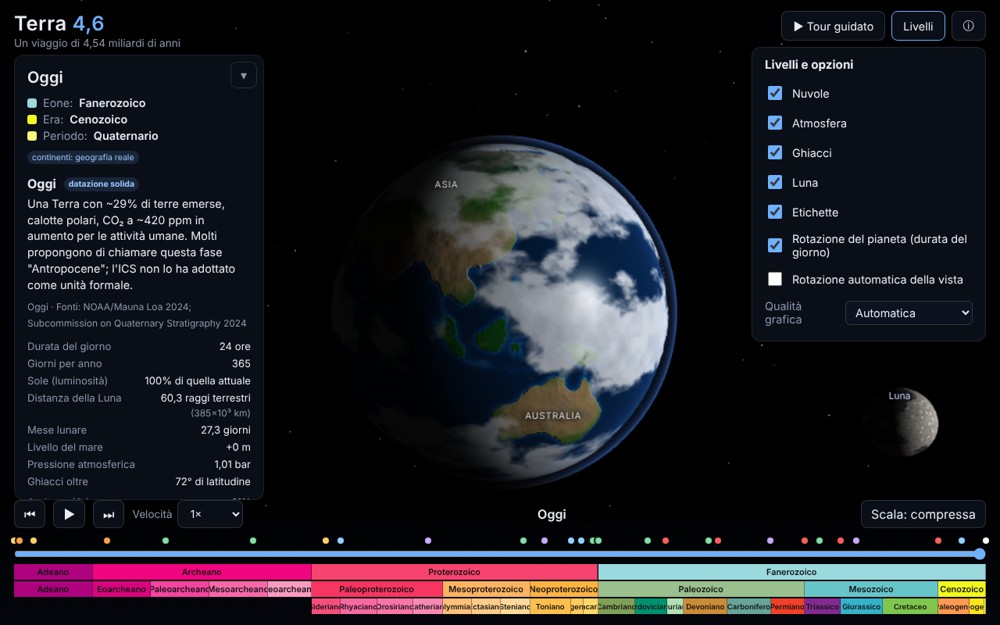

# Terra 4,6

Simulazione 3D interattiva dell'evoluzione della Terra, da 4,54 miliardi di anni fa a oggi.
Scorri la linea del tempo e guarda il globo trasformarsi — superficie, oceani, atmosfera, ghiacci, nuvole,
continenti, Luna, Sole — mentre il pannello spiega che cosa accadde, **con le fonti e con il grado di incertezza**.

Tono divulgativo ma scientificamente prudente: dove un dato è incerto, l'applicazione lo dice.
Interfaccia, commenti e nomi nel codice sono in italiano.



## Avvio rapido

```bash
npm install
npm run dev        # server di sviluppo (http://localhost:5173)
```

```bash
npm run build      # controllo dei dati + type-check + build di produzione in dist/
npm run preview    # prova locale della build
npm run verifica-dati   # solo i controlli sui dati e sull'interpolazione
```

Serve Node 20.19 o successivo (provato con Node 22). Nessun backend: la build è interamente statica.

## Pubblicazione su GitHub Pages

La build usa percorsi relativi (`base: './'` in `vite.config.ts`), quindi funziona da qualsiasi sottocartella.
In `.github/workflows/pages.yml` c'è un workflow pronto: abilita **Settings → Pages → Source: GitHub Actions** e fai
push sul ramo `main`. La build servita da una sottocartella è stata provata senza errori in console.

## Che cosa si può fare

- **Linea del tempo** con scala *lineare* o *compressa* (gli ultimi 540 milioni di anni occupano il 40% della barra,
  invece del ~12%), play/pausa, velocità da 0,25× a 8×, salto all'evento precedente/successivo.
- **Bande** per eoni, ere e periodi con i colori della Tabella Cronostratigrafica Internazionale (ICS) e **marcatori**
  cliccabili per gli eventi (colorati per tipo: estinzioni, impatti, clima, vita, tettonica…).
- **Tour guidato**: attraversa le 22 tappe principali con un viaggio fluido, una scheda esplicativa e avanzamento
  automatico (pausa, avanti, indietro, esci).
- **Livelli**: nuvole, atmosfera, ghiacci, Luna, etichette; rotazione del pianeta (durata del giorno) e della vista;
  qualità grafica (automatica, alta, bassa).
- **Pannello informazioni**, comprimibile: eone/era/periodo, durata del giorno con intervallo di incertezza,
  giorni per anno, luminosità del Sole, distanza della Luna e mese lunare, livello del mare, pressione, ghiacci,
  mini grafici di O₂ e CO₂ con fascia di incertezza, e descrizione dell'evento più vicino con fonti e confidenza.
- **Effetti** di impatti (Theia, bombardamento tardivo, Chicxulub) ed eruzioni (Trappe Siberiane, provincia
  dell'Atlantico Centrale).
- Layout adattivo per tablet e telefono (provato in emulazione di viewport, non su dispositivi reali); i controlli
  standard (pulsanti, slider, selettori) sono raggiungibili da tastiera.

**Scorciatoie**: `spazio` riproduci/pausa · `N` / `P` evento successivo / precedente · `T` tour · `Esc` chiude tour o finestre.

## Architettura

```
src/
├─ data/
│  ├─ timeline.ts      UNICA fonte dei dati: eoni, ere, periodi, eventi, tracce dei parametri (con fonti)
│  └─ validazione.ts   controlli di coerenza (ordine, intervalli, fonti presenti)
├─ state/
│  ├─ scala.ts         posizione dello slider ↔ tempo (lineare / compressa)
│  ├─ tempo.ts         tempo corrente, riproduzione, viaggio animato
│  └─ stato.ts         interpolazione delle tracce → oggetto StatoTerra
├─ scene/              solo rendering: legge SOLO lo StatoTerra
│  ├─ scena.ts         renderer, camera, gruppi, qualità adattiva, avvio degli effetti
│  ├─ superficie.ts    "bake" della superficie su texture (continenti, oceani, ghiacci, magma, vegetazione)
│  ├─ globo.ts, nuvole.ts, atmosfera.ts, luna.ts, sole.ts, stelle.ts, effetti.ts
│  ├─ continenti.ts    modello procedurale delle placche e dei supercontinenti
│  ├─ mappeTerre.ts    gestione delle mappe terra/mare per istanti, con dissolvenza
│  └─ caricaMappe.ts   caricatore delle mappe paleogeografiche (con controllo della licenza)
├─ shaders/*.glsl      GLSL personalizzato: superficie, globo, nuvole, atmosfera, Luna, particelle…
├─ ui/                 timeline, pannello, layer, tour, etichette, schede
└─ mappe/              mappe paleogeografiche opzionali + manifest.json
scripts/               verifica-dati.ts, prepara_mappa.py
```

### Scelte principali e perché

- **Dati separati dal rendering.** `timeline.ts` contiene tutti i numeri, ciascuno con fonte o la dicitura
  «valore approssimato». `stato.ts` li interpola in un unico oggetto `StatoTerra`; la scena e l'interfaccia leggono
  solo quello. Negli shader non ci sono date.
- **Tracce, non keyframe globali.** Ogni parametro ha la sua lista di punti (con intervallo min/max): così ognuno
  può avere i suoi tempi (la glaciazione cambia in pochi Ma, la durata del giorno in miliardi) e ogni punto la sua fonte.
  Tra due punti l'interpolazione è lineare (logaritmica per la CO₂); i salti rapidi si ottengono con punti ravvicinati.
- **Superficie "baked".** Il calcolo (rumore, continenti, biomi, ghiacci, magma) è costoso, ma cambia solo quando cambia il tempo.
  Quindi si disegna su una texture equirettangolare a due target (albedo + dati) e il globo la campiona.
  **Risoluzione adattiva**: 1024×512 mentre il tempo scorre, 2048×1024 dopo 0,35 s di pausa; inoltre il *pixel ratio*
  si adatta ai fps misurati (modalità «automatica»).
- **Scale visive dichiarate.** La Luna reale (60 raggi terrestri, minuscola) non si vedrebbe: distanza e dimensione sono
  compresse (vedi `scene/orbite.ts`). Stesso discorso per il disco del Sole e per l'altezza delle nuvole.
- **Controllo automatico dei dati.** `npm run verifica-dati` (eseguito da `npm run build` e dal workflow) controlla
  che gli intervalli ICS siano contigui, gli eventi ordinati, le tracce coprano 4540–0 Ma con `min ≤ v ≤ max`,
  ogni punto abbia la fonte, e la scala sia invertibile. In sviluppo gli stessi controlli girano all'avvio.

## Come aggiungere o cambiare i dati

- **Un evento**: aggiungi un oggetto a `EVENTI` in `src/data/timeline.ts` (ordinato per data decrescente), con
  `ma`, `incertezzaMa`, `confidenza` (`alta`/`media`/`bassa`), testo e **fonte**. Con `tour: true` compare nel tour;
  con `effetto` lancia un impatto o un'eruzione.
- **Un parametro**: aggiungi punti a una traccia (`ma` decrescente, `v`, opzionalmente `min`/`max`, **`fonte`**). Se
  scrivi «valore approssimato» sii onesto sul fatto che è una scelta di divulgazione, non una misura.
- Dopo ogni modifica: `npm run verifica-dati`.

## Continenti: modello procedurale e mappe reali

**Versione 1 (inclusa): continenti procedurali.** Otto «placche» derivano attorno a poli di rotazione (velocità
dell'ordine di 0,2–0,6 °/Ma, come le placche reali) e si riuniscono nei periodi dei supercontinenti (Pangea,
Rodinia, Columbia/Nuna, Pannotia, Kenorland). **È una rappresentazione illustrativa, non paleogeografia:** solo
le *date* dei supercontinenti vengono dalla letteratura. L'interfaccia lo segnala («continenti: modello illustrativo»).
Le terre di **oggi** vengono dalla maschera Natural Earth (pubblico dominio) in `src/assets/terre_oggi.png` e sfumano nel
modello procedurale oltre 60 Ma dall'ultima mappa disponibile.

**Versione 2 (predisposta): mappe paleogeografiche reali per singoli istanti**, con dissolvenza tra una e l'altra.
Il loader c'è (`scene/caricaMappe.ts`, `scene/mappeTerre.ts`); i dati **non sono inclusi**: non conosco la licenza di
quelli che potresti voler usare, e non li scarico né li ridistribuisco.

### Dove procurarsi le mappe

- **PALEOMAP Project** (C. R. Scotese): mappe paleogeografiche globali per molte epoche. Cerca il sito ufficiale del progetto.
- **GPlates / EarthByte**: modelli di ricostruzione tettonica e dati associati (per esempio i modelli di Müller et al.,
  Merdith et al.); con GPlates puoi esportare poligoni delle terre emerse a istanti scelti e rasterizzarli.

### Come verificare la licenza (prima di aggiungere qualsiasi cosa)

1. Trova la **pagina ufficiale del dataset** (non una copia su un altro sito) e leggi i termini d'uso/la licenza.
2. Controlla che **consenta la ridistribuzione** dei file (o dei derivati, come la maschera che ne ricavi) e **l'uso
   in un'applicazione pubblicata**; annota gli obblighi (attribuzione, condivisione allo stesso modo, divieto di uso commerciale…).
3. Se la licenza non è chiara, **scrivi all'autore** e conserva la risposta. «Visibile online» non significa «libero».
4. Cita la fonte con le richieste dell'autore; i crediti compaiono anche nella finestra ⓘ dell'applicazione.
5. Solo dopo, dichiara la licenza nel manifest con `"licenzaVerificata": true`. Senza questo campo la mappa viene
   **ignorata** con un avviso in console.

### Come aggiungere una mappa

1. Ricava una **maschera terra/mare equirettangolare** (rapporto 2:1, terra chiara, mare scuro).
2. Convertila nel formato dell'app (PNG 2048×1024; R = maschera nitida, G = sfocata, B = molto sfocata):

   ```bash
   python3 scripts/prepara_mappa.py maschera.png src/mappe/scotese_100Ma.png
   ```

   (richiede Pillow e NumPy; opzioni `--invertita`, `--soglia`)
3. Dichiarala in `src/mappe/manifest.json`:

   ```json
   { "mappe": [
     { "file": "scotese_100Ma.png", "ma": 100,
       "fonte": "PALEOMAP Project, C. R. Scotese",
       "licenza": "…", "licenzaUrl": "https://…", "licenzaVerificata": true }
   ] }
   ```
4. Riavvia. Tra due mappe vicine l'aspetto sfuma in dissolvenza; fuori dall'intervallo coperto torna gradualmente al modello procedurale.

La procedura è stata collaudata con una mappa di prova (poi rimossa): voce verificata caricata e sfumata
correttamente, voce non verificata scartata con avviso, crediti mostrati nell'interfaccia.

> **Nota sulla texture di oggi.** Il progetto prevedeva la NASA *Blue Marble*. Durante lo sviluppo l'host di NASA non
> era raggiungibile dall'ambiente di lavoro, e comunque una foto fissa non si adatterebbe alle epoche (vegetazione,
> ghiacci, nuvole sono calcolati dagli shader). Si usa quindi la maschera Natural Earth. Se vuoi comunque una texture a colori
> per «oggi», puoi aggiungerla come ulteriore livello: la Blue Marble è di NASA/Visible Earth e il suo uso va attribuito.

## Limiti e onestà scientifica

- **I continenti del passato sono illustrativi** (vedi sopra). Supercontinenti come Columbia/Nuna e Pannotia sono
  ipotesi dibattute: nell'applicazione compaiono con «(ipotesi)».
- **Prima di ~1,4 miliardi di anni fa** durata del giorno, distanza della Luna, CO₂ e pressione provengono da
  modelli e hanno intervalli ampi. Subito dopo la formazione della Luna il giorno poteva durare 2,5–7 ore secondo i modelli.
- **Date contestate o recenti**: bombardamento tardivo (ipotesi), prime tracce di vita, origine della fotosintesi
  ossigenica, oceani dell'Adeano (inferiti da zirconi). Ciascuna ha `confidenza` e fonti.
- **Scale non fisiche**: Luna, Sole, nuvole, durata degli effetti.
- **Effetti di impatti ed eruzioni**: animazioni, non simulazioni; le eruzioni cadono su terre generiche, non
  sulle vere province magmatiche.
- **Prestazioni**: l'obiettivo è 60 fps su un portatile recente (superficie precalcolata, risoluzione adattiva), ma
  i test dello sviluppo sono stati fatti con rendering software, quindi i fps reali vanno verificati sul tuo dispositivo.
- **Fonti bibliografiche**: le citazioni in `timeline.ts` sono riportate dalla letteratura nota allo sviluppo e non sono
  state riverificate una a una. **Prima di una pubblicazione divulgativa vanno controllate**, in particolare le date più
  recenti e i valori del Neoproterozoico. Lo stesso vale per i colori ICS dei periodi del Proterozoico, da confrontare
  con i file cromatici ufficiali.

## Fonti principali

Cronologia e colori: ICS, *International Chronostratigraphic Chart* v2023 (stratigraphy.org).
Età della Terra e dei corpi del Sistema Solare: Patterson 1956; Dalrymple 2001; Bouvier & Wadhwa 2010.
Luna: Canup & Asphaug 2001; Canup 2004; Ćuk & Stewart 2012; Elkins-Tanton et al. 2011; Maurice et al. 2020; Hiesinger et al. 2011.
Durata del giorno e distanza della Luna: Wells 1963; Williams 2000; Meyers & Malinverno 2018; Zahnle & Walker 1987; Webb 1982.
Sole: Gough 1981; Bahcall et al. 2001. Atmosfera: Lyons et al. 2014; Zahnle et al. 2010; Som et al. 2012; Trainer et al. 2006; Arney et al. 2016.
Ossigeno e CO₂: Berner 2009; Foster et al. 2017; Lüthi et al. 2008; Sheldon 2006; Kanzaki & Murakami 2015.
Glaciazioni: Evans et al. 1997; Hoffman et al. 1998, 2017; Macdonald et al. 2010; Rooney et al. 2015; Montañez & Poulsen 2013; Clark et al. 2009.
Livello del mare: Haq & Schutter 2008; Miller et al. 2005; Lambeck et al. 2014.
Estinzioni di massa: Burgess et al. 2014; Blackburn et al. 2013; Renne et al. 2013; Bond & Grasby 2017; McGhee 2013.
Origine dell'uomo: Hublin et al. 2017; Richter et al. 2017. Il dettaglio per ogni evento e parametro è in `src/data/timeline.ts`.

## Crediti e licenze

- Grafica 3D: [three.js](https://threejs.org) (MIT).
- Terre emerse di oggi: [Natural Earth](https://www.naturalearthdata.com) 1:50m, pubblico dominio, tramite `world-atlas` (ISC). Vedi `src/assets/LEGGIMI.txt`.
- Strumenti di build: Vite, TypeScript, tsx.
- Il codice di questo progetto non ha ancora una licenza dichiarata: aggiungine una prima della pubblicazione.
